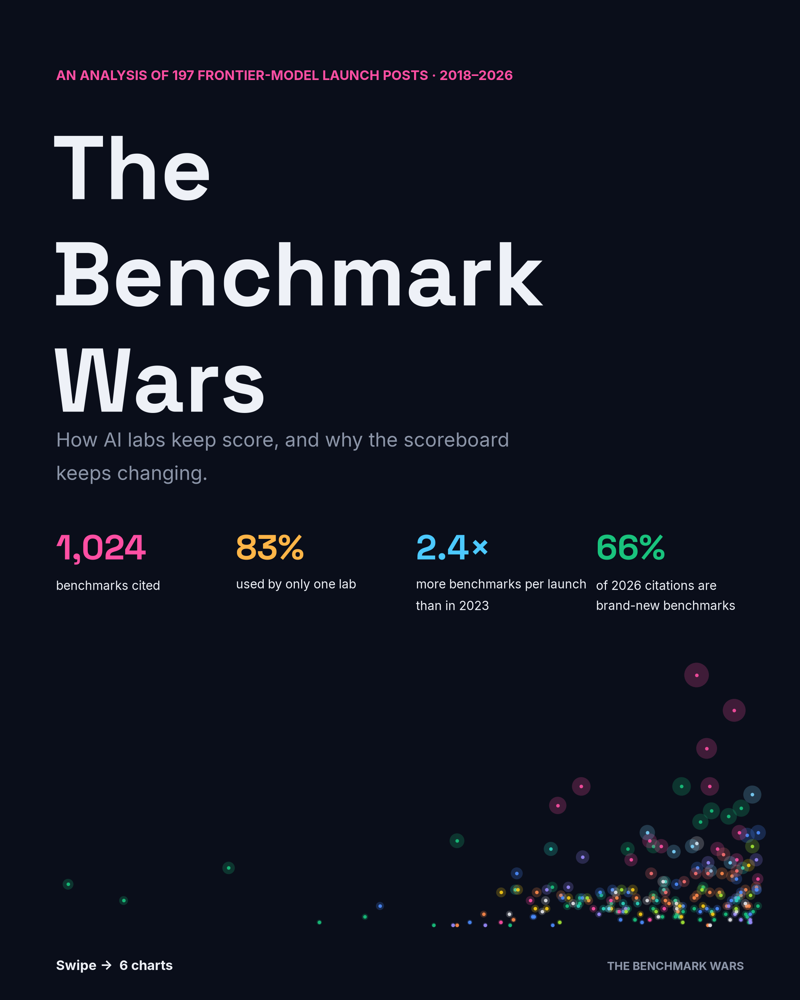
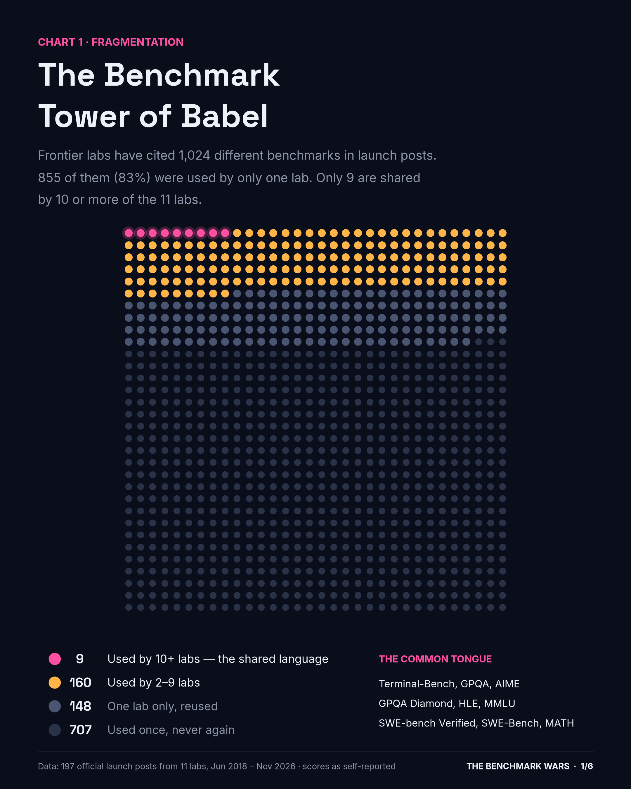
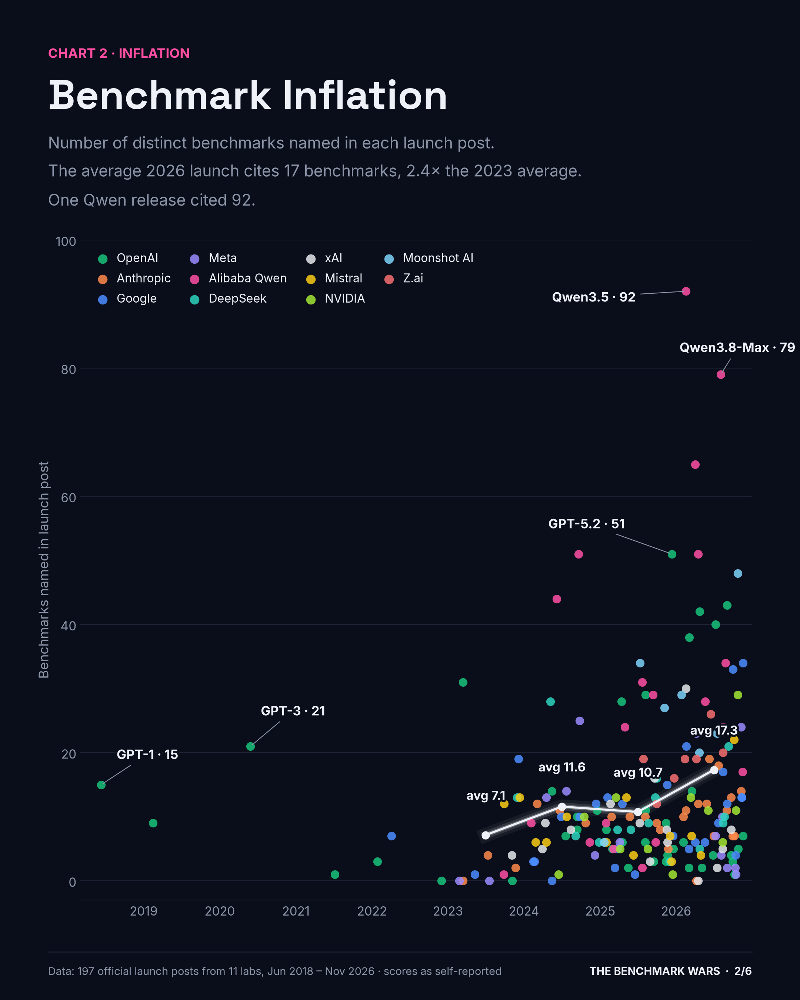
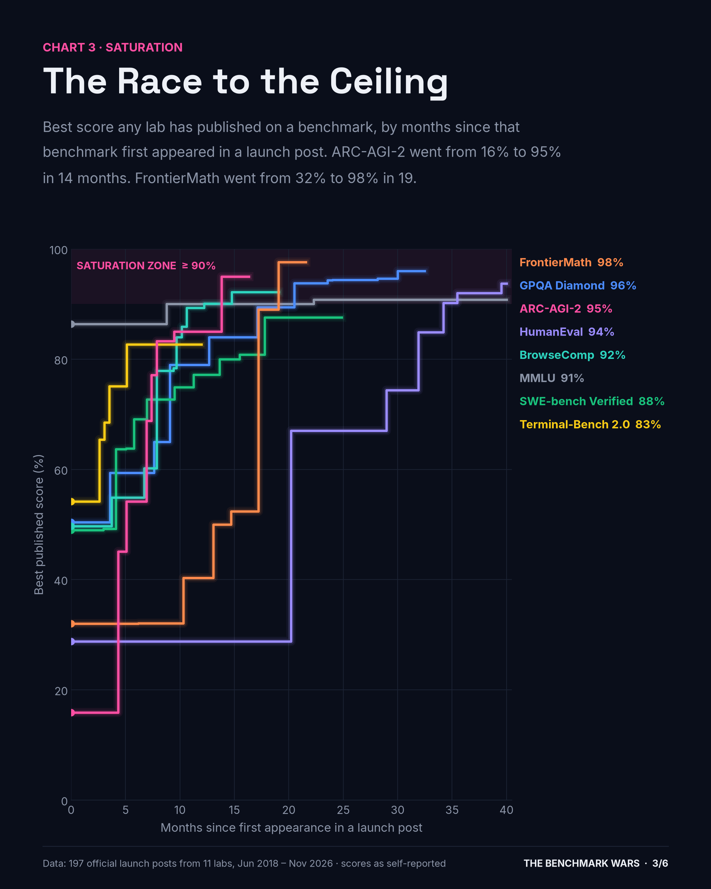
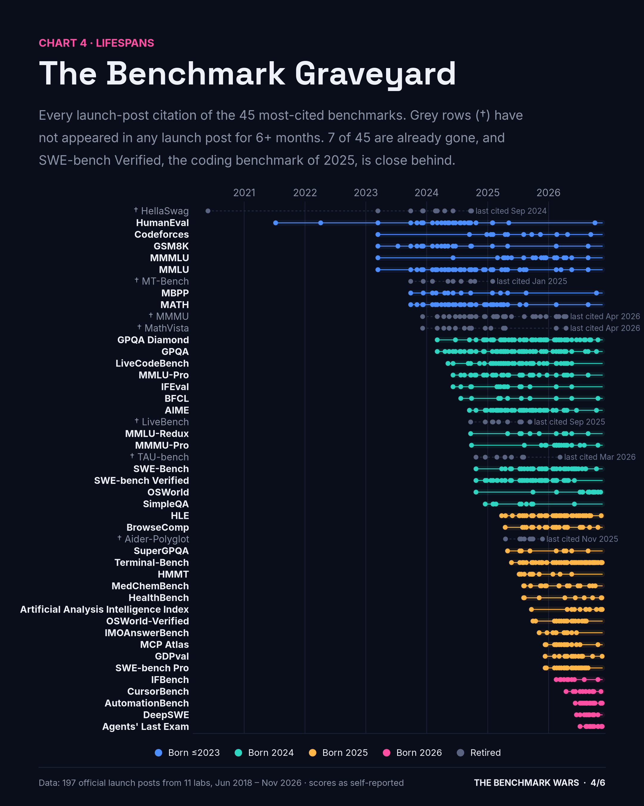
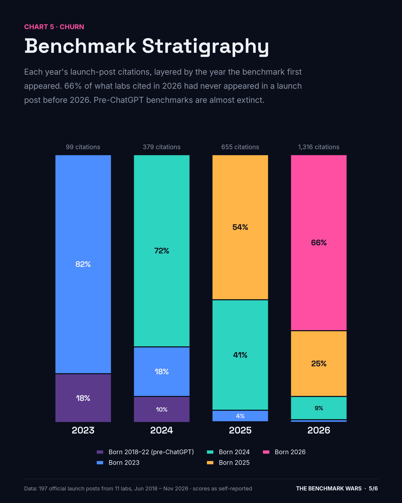
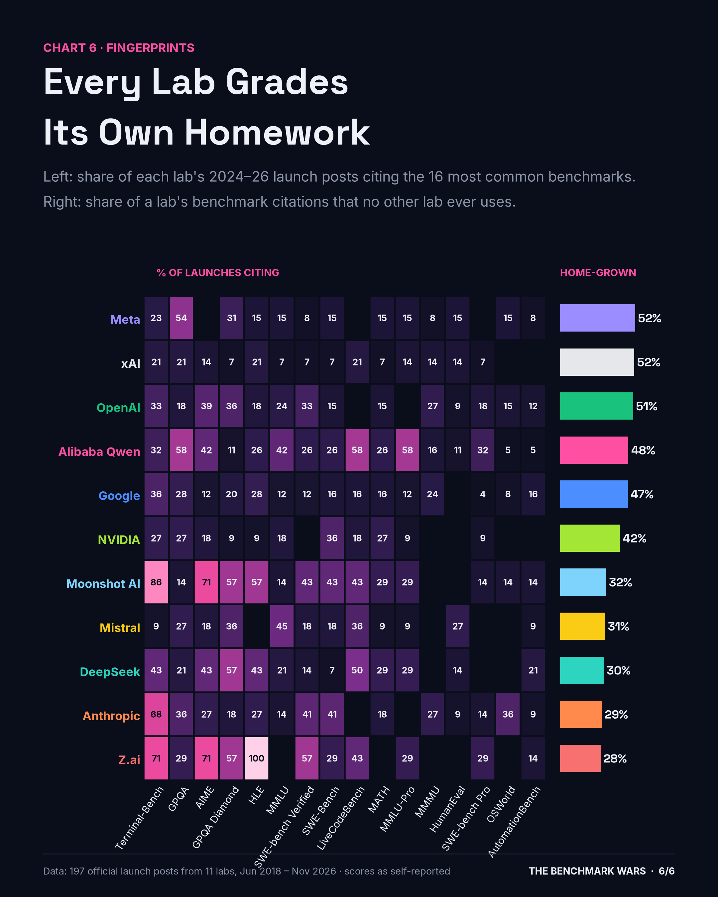

# The Benchmark Wars: What 197 AI Launch Posts Reveal About How Labs Keep Score

Every frontier-model launch looks the same. There is a blog post, a hero chart, and a table of benchmark scores where the new model's column is in bold. We have learned to skim it: higher on GPQA, higher on SWE-bench, a new record on whatever exam was invented last quarter.

I wanted to know what that table looks like when you stop reading it one launch at a time. So I built a dataset of every benchmark cited in **197 official launch posts from 11 labs**: OpenAI, Anthropic, Google, Meta, Alibaba Qwen, DeepSeek, xAI, Mistral, NVIDIA, Moonshot AI and Z.ai. It starts with GPT-1 in June 2018 and ends with Gemini 4 Neon in November 2026. That comes to roughly 3,000 individual results and a little over 1,000 distinct benchmarks.

Taken together, the launch tables show that AI labs do not share a scoreboard. Each lab mostly picks its own tests, the number of tests keeps growing, and the whole set is replaced about once a year.

Here are six charts that show it.

## 1. The Tower of Babel: 1,024 benchmarks, almost no common language

Across all 197 launch posts, labs cited **1,024 different benchmarks** (grouped into families, so "GPQA Diamond" and "GPQA Diamond (no tools)" count once).

- **855 of them (83%) were used by only one lab.**
- **707 (69%) appeared in exactly one launch post** and were never cited again.
- **Only 9 were used by 10 or more of the 11 labs:** Terminal-Bench, GPQA, GPQA Diamond, AIME, Humanity's Last Exam, MMLU, SWE-bench, SWE-bench Verified and MATH.

Those nine are the shared language of the industry. Everything else is a dialect. When a launch post shows a table with 30 rows, most of those rows can't be compared with anything another lab has published.

New capabilities do need new tests. But it means the phrase "state of the art" usually comes with an unstated condition: *on the benchmarks we chose to report.*

## 2. Benchmark inflation: launch tables keep getting longer

GPT-1 reported 15 benchmarks in 2018. Then came a quiet period: in 2022 and early 2023, many launch posts cited almost nothing. ChatGPT, the original LLaMA blog post, Claude 1 and GPT-4 Turbo cited no benchmarks at all.

Since then, the tables have grown:

| Year | Average benchmarks per launch post |
|---|---|
| 2023 | 7.1 |
| 2024 | 11.6 |
| 2025 | 10.7 |
| 2026 | 17.3 |

The average 2026 launch cites **2.4× as many benchmarks** as the average 2023 launch. The outliers are bigger still. Alibaba's **Qwen3.5 launch in February 2026 named 92 benchmarks**, followed by Qwen3.8-Max (79) and Qwen3.6-Plus (65). OpenAI's GPT-5.2 post named 51.

Some of this is maturity: coding, browsing, computer use and vision each need their own tests. But a longer table also gives a lab more room to choose. With 90 rows, any model will lead somewhere, and the hero chart can show those rows.

## 3. The race to the ceiling: "impossible" benchmarks fall in about 18 months

For eight well-known benchmarks, I took the best score any lab had published and plotted it against the number of months since that benchmark first appeared in a launch post.

The pattern repeats:

- **MMLU** debuted in a frontier launch at 86.4% (GPT-4, March 2023) and crossed 90% within **9 months** (Gemini Ultra).
- **HumanEval** debuted at 28.8% (Codex, July 2021) and reached 90.2% (GPT-4o) about **34 months** later.
- **GPQA Diamond**, the "Google-proof" PhD-level science test, started at 50.4% with Claude 3 Opus in March 2024. It crossed 90% with Gemini 3 Pro in November 2025, about **20 months** later, and the best published score is now 96%.
- **BrowseComp** went from 49.7% (o3) to 90.1% in about **12 months**.
- **ARC-AGI-2**, designed specifically to resist current methods, went from **15.9% (Grok 4, July 2025) to 95% (GPT-6 Astra, September 2026) in 14 months.**
- **FrontierMath**, research-level mathematics, went from **32% (o3-mini, January 2025) to 97.6% in 19 months.**

SWE-bench Verified (49% → 87.6%) and Terminal-Bench 2.0 (54% → 83% in just five months) haven't crossed 90% yet, but they are on the same curve.

One caveat matters here. These are **self-reported numbers from the labs' own launch posts**, often with different settings for compute, tools and attempts. "Best published score" means the most favourable configuration a lab chose to publish. That is part of the story: the ceiling is reached faster when every lab reports its best run.

Still, the overall result is hard to dispute. A benchmark that is meant to be hard now lasts about a year and a half in frontier launch posts before it stops telling models apart.

## 4. The benchmark graveyard: what happens when a test stops being useful

When a benchmark saturates, labs don't announce that it's retired. They just stop citing it.

This chart follows the 45 most-cited benchmarks. Each dot is one launch post that cited it. Rows marked † haven't appeared in any launch post for at least six months. **7 of the 45 are already gone:**

- **HellaSwag**, a mainstay since GPT-3 (last cited September 2024)
- **MT-Bench** (January 2025)
- **LiveBench** (September 2025)
- **Aider-Polyglot** (November 2025)
- **TAU-bench** (March 2026)
- **MMMU and MathVista** (both last cited April 2026)

SWE-bench Verified is close behind. In 2025 it was *the* coding benchmark, cited in 41 launch posts by 10 labs and the main number in almost every coding claim. Then SWE-bench Pro appeared in December 2025 and labs moved to the newer, harder version. Verified's last citation was NVIDIA's Nemotron 3 Ultra in June 2026.

Meanwhile, the newest rows at the bottom of the chart are full of names that didn't exist two years ago: AutomationBench, Agents' Last Exam, DeepSWE, CursorBench, MCP Atlas, GDPval. Benchmarks have shifted from *knowledge* (MMLU, HellaSwag) to *reasoning* (GPQA, AIME, HLE) to *agentic work* (Terminal-Bench, OSWorld, AutomationBench). The graveyard shows that shift.

## 5. Benchmark stratigraphy: two-thirds of 2026's scoreboard is new

Geologists date rock by its layers. This chart does the same for benchmarks: every citation in a given year, layered by the year that benchmark first appeared in a launch post.

The result shows how fast the scoreboard turns over:

- In **2024**, 72% of citations were benchmarks first seen that year, and 10% were pre-ChatGPT benchmarks from 2018–2022.
- In **2025**, 54% were new that year.
- In **2026**, **66% of all 1,316 citations were benchmarks that had never appeared in a launch post before 2026.** Another 25% were from 2025.

Pre-ChatGPT benchmarks are almost gone: **one citation out of 1,316 in 2026.** The tests that defined language-model progress for five years (GLUE, SuperGLUE, LAMBADA, HellaSwag, the early reading-comprehension sets) have almost entirely disappeared from frontier launches.

This changes how you should read any long-term "AI progress" chart. There is no continuous ruler. Each year's scoreboard is mostly built from new tests, so comparing a 2026 model with a 2024 model on the 2026 scoreboard often means comparing it on tests the 2024 model never had a chance to optimise for.

## 6. Lab fingerprints: every lab grades its own homework

The last chart shows each lab's evaluation habits. The heatmap shows how often each lab's 2024–2026 launch posts cite the 16 most common benchmarks. The bar on the right shows each lab's **home-grown share**: the fraction of its benchmark citations that no other lab ever uses.

A few patterns stand out:

- **Meta (52%), xAI (52%) and OpenAI (51%)** have the most home-grown citations. About half of what they report can't be found in any other lab's launch posts. OpenAI's MedChemBench, for example, appears in 16 of its launch posts and in no one else's.
- **Z.ai (28%), Anthropic (29%) and DeepSeek (30%)** stick most closely to shared benchmarks, which makes their claims easiest to check against other labs.
- Labs have favourite benchmarks. **Moonshot AI cites Terminal-Bench in 86% of its recent launches.** **Z.ai cites Humanity's Last Exam in 100% of them.** Anthropic leads with Terminal-Bench (68%) and is one of the few labs that regularly reports OSWorld. Alibaba Qwen covers the broadest range, citing GPQA, LiveCodeBench and MMLU-Pro each in 58% of its launches.

You can learn a lot about a lab's strategy from which benchmarks it puts first. A lab that leads with agentic coding and computer use is telling you who it is building for. A lab that avoids a shared benchmark everyone else reports is also telling you something.

## What this means if you build with these models

These charts changed how I read a launch post:

1. **Start with the shared nine.** If a lab reports GPQA Diamond, SWE-bench, Terminal-Bench, AIME or HLE, you can compare it with competitors. Look at those rows first and treat everything else as marketing until it is independently reproduced.
2. **Notice what's missing.** With 1,024 benchmarks available, *leaving one out* is a choice. If a lab stops reporting a benchmark its competitors still cite, ask why.
3. **Expect any benchmark to last about 18 months.** A gap on a nearly saturated test is mostly noise.
4. **Build your own evals.** Public benchmarks are temporary; a scoreboard built on your own tasks and failure modes lasts.

## Conclusion: read the scoreboard, not just the score

Benchmarks were meant to be a shared ruler for AI progress. Eight years of launch posts show something closer to a negotiation. Most benchmarks are used by one lab, launch tables keep growing, hard tests hit the ceiling in about 18 months, and two-thirds of 2026's citations are for tests that are new this year.

None of this makes benchmarks useless. It means a launch post shows the view of a model its lab chose to show. The useful questions are which tests were picked, which were left out, and how close each is to saturation.

Next year's launches will mostly be scored on tests that don't exist yet. Knowing how the scoreboard is built will tell you more than the top number.

---

### Methodology

The dataset covers 197 official, first-party launch posts and model pages from 11 labs, from GPT-1 (11 June 2018) to 18 November 2026. Benchmarks were extracted from tables, text, alt text and OCR of chart images, grouped into families and counted once per announcement. Scores are as published by each lab, not independently verified, and settings (tools, attempts, compute) vary between launches. "Best published score" in Chart 3 is the highest number any lab reported for that benchmark up to that date. A benchmark counts as "retired" in Chart 4 if no launch post cited it in the six months before 18 November 2026.
